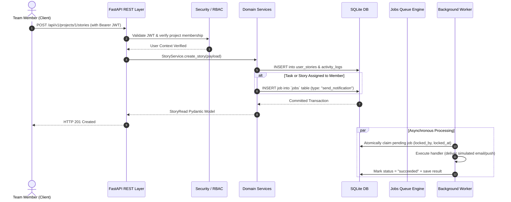
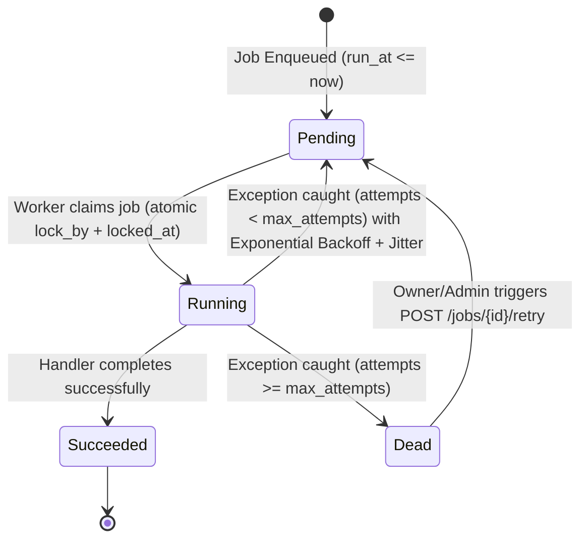

# System Architecture

## 1. Overview
The **Agile Project Management Tool (AgilePulse)** is engineered as a high-reliability, modular web application optimized for small agile teams (3–10 members). It enforces a strict 3-tier work hierarchy:

$$\text{Project} \longrightarrow \text{User Story} \longrightarrow \text{Task}$$

- **Projects** encapsulate high-level roadmaps, repositories of user stories, team memberships, and audit logs.
- **User Stories** capture persona-driven functional requirements with estimation points, status columns, and auto-computed completion percentages based on child tasks.
- **Tasks** represent atomic engineering deliverables with hourly estimates, assignees, and deadlines.

---

## 2. Component Architecture Diagram

```mermaid
graph TD
    Client["React 18 + Vite SPA (Client Browser)"]
    Nginx["Reverse Proxy / Static Server (Nginx)"]
    FastAPI["FastAPI REST Application (Uvicorn ASGI)"]
    Worker["Async Background Worker (Polling Engine)"]
    DB[("Persistent SQLite DB (PRAGMA foreign_keys=ON)")]

    Client -->|Static Assets & Bundle| Nginx
    Client -->|REST API Requests & JWT Auth| Nginx
    Nginx -->|Proxy /api/v1| FastAPI
    FastAPI -->|Queries & Transactions| DB
    FastAPI -->|Enqueue Jobs (Jobs Table)| DB
    Worker -->|Poll, Claim & Backoff| DB
    Worker -->|Execute Handlers (Reports, Reminders, Alerts)| DB
```

---

## 3. Request Lifecycle Flow



---

## 4. Background Job Queue Flow & Retry Strategy

Celery + Redis introduces unnecessary operational complexity (two additional daemons, Redis memory serialization, and connection broker management) for small teams of 3–10 users. Instead, AgilePulse implements a robust **Database-Backed Job Queue** directly in SQLite:



### Concurrency & Safe Claiming
- Workers execute atomic claim queries:
  ```sql
  SELECT * FROM jobs
  WHERE status = 'pending' AND run_at <= :now
  ORDER BY run_at ASC, created_at ASC
  LIMIT 1;
  ```
- The winning worker updates `status = 'running'`, `locked_by = :worker_id`, `locked_at = :now`, and increments `attempts += 1` within an atomic transaction.
- **Stale Lock Recovery**: Every 60 seconds, the worker scans for any job stuck in `running` with `locked_at` older than 300 seconds (e.g. from an ungraceful container kill) and automatically recovers it to `pending`.
- **Exponential Backoff Formula with Jitter**:
  $$\text{Delay} = \text{base\_delay} \times 2^{(\text{attempts} - 1)} + \text{uniform}(0.1, 1.0)$$

---

## 5. Directory Structure
```
kpit-project/
├── backend/
│   ├── alembic/              # Database migration scripts
│   ├── app/
│   │   ├── api/              # Versioned API routes & dependency injection
│   │   ├── core/             # Configuration, DB engine, security, exceptions
│   │   ├── models/           # SQLAlchemy 2.0 ORM models
│   │   ├── repositories/     # Data persistence abstraction
│   │   ├── schemas/          # Pydantic v2 schemas
│   │   ├── services/         # Core business logic & rules
│   │   ├── worker/           # Polling job queue & async handlers
│   │   └── main.py           # FastAPI application entrypoint
│   ├── scripts/              # Seed scripts & standalone worker CLI
│   ├── tests/                # Pytest unit & integration test suite
│   ├── requirements.txt      # Python dependencies
│   ├── pyproject.toml        # Ruff, Black, Pytest configurations
│   └── Dockerfile            # Container definition
├── frontend/
│   ├── src/
│   │   ├── api/              # Typed REST client modules
│   │   ├── components/       # Reusable accessible UI components
│   │   ├── context/          # Auth and Toast context providers
│   │   ├── pages/            # View pages (Kanban, Tree, Dashboard, Reports...)
│   │   ├── test/             # Vitest component test suites
│   │   ├── types/            # TypeScript domain interfaces
│   │   ├── App.tsx           # Route layout & query providers
│   │   └── main.tsx          # React DOM entrypoint
│   ├── package.json          # Frontend dependencies & scripts
│   ├── vite.config.ts        # Vite & Vitest configuration
│   ├── tailwind.config.js    # Tailwind theme styling
│   └── Dockerfile            # Multi-stage production Nginx container
├── docs/                     # Full engineering documentation
├── docker-compose.yml        # Unified multi-service deployment
├── api_collection.http       # Interactive REST API client collection
└── README.md                 # Complete project documentation
```
