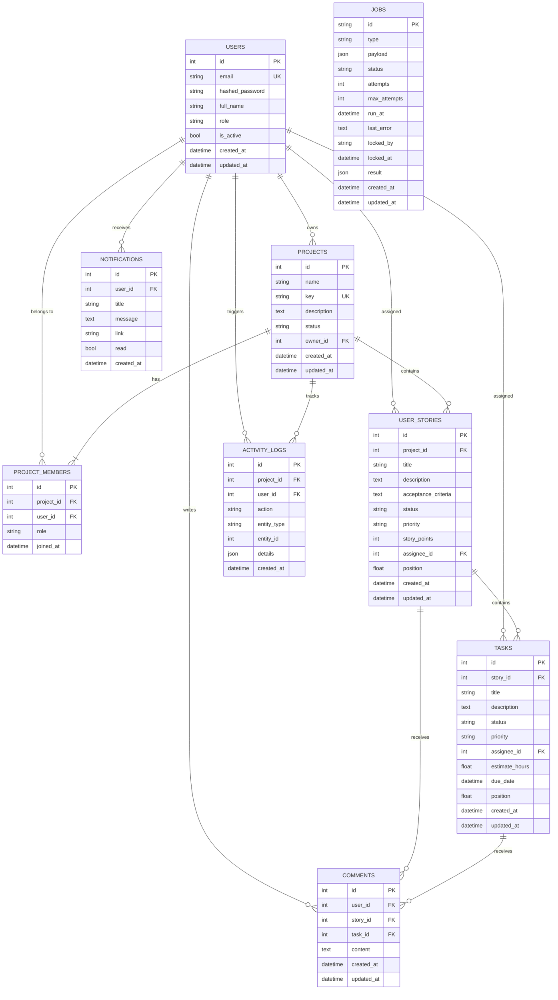

# Database Schema Documentation

AgilePulse utilizes SQLite as its persistent storage engine, managed via SQLAlchemy 2.0 ORM and version-controlled using Alembic migrations.

---

## 1. Entity-Relationship (ER) Diagram



---

## 2. Table & Column Definitions

### `users`
| Column | Type | Constraints | Description |
|---|---|---|---|
| `id` | INTEGER | PRIMARY KEY AUTOINCREMENT | Unique user identifier |
| `email` | VARCHAR(255) | UNIQUE, NOT NULL, INDEX | Login email address |
| `hashed_password` | VARCHAR(255) | NOT NULL | Salted bcrypt password hash |
| `full_name` | VARCHAR(255) | NOT NULL | User's display name |
| `role` | VARCHAR(50) | NOT NULL, DEFAULT 'user' | System role (`admin` or `user`) |
| `is_active` | BOOLEAN | NOT NULL, DEFAULT TRUE | Soft deactivation flag |
| `created_at` | DATETIME | NOT NULL | Record creation timestamp (UTC) |
| `updated_at` | DATETIME | NOT NULL | Record last update timestamp (UTC) |

### `projects`
| Column | Type | Constraints | Description |
|---|---|---|---|
| `id` | INTEGER | PRIMARY KEY AUTOINCREMENT | Unique project identifier |
| `name` | VARCHAR(255) | NOT NULL | Project title |
| `key` | VARCHAR(10) | UNIQUE, NOT NULL, INDEX | Short code prefix (e.g. "APM") |
| `description` | TEXT | NULLABLE | High-level roadmap summary |
| `status` | VARCHAR(50) | NOT NULL, DEFAULT 'active', INDEX | Status: `active` or `archived` |
| `owner_id` | INTEGER | FOREIGN KEY (`users.id` ON DELETE RESTRICT), INDEX | Project creator |
| `created_at` | DATETIME | NOT NULL | Record creation timestamp (UTC) |
| `updated_at` | DATETIME | NOT NULL | Record last update timestamp (UTC) |

### `project_members`
| Column | Type | Constraints | Description |
|---|---|---|---|
| `id` | INTEGER | PRIMARY KEY AUTOINCREMENT | Membership record identifier |
| `project_id` | INTEGER | FOREIGN KEY (`projects.id` ON DELETE CASCADE), INDEX | Target project |
| `user_id` | INTEGER | FOREIGN KEY (`users.id` ON DELETE CASCADE), INDEX | Target member |
| `role` | VARCHAR(50) | NOT NULL, DEFAULT 'member' | Project role: `owner` or `member` |
| `joined_at` | DATETIME | NOT NULL | When member was added |
*Composite Unique Constraint*: `uq_project_member` (`project_id`, `user_id`).

### `user_stories`
| Column | Type | Constraints | Description |
|---|---|---|---|
| `id` | INTEGER | PRIMARY KEY AUTOINCREMENT | Story identifier |
| `project_id` | INTEGER | FOREIGN KEY (`projects.id` ON DELETE CASCADE), INDEX | Parent project |
| `title` | VARCHAR(255) | NOT NULL | User story requirement title |
| `description` | TEXT | NULLABLE | Narrative details |
| `acceptance_criteria` | TEXT | NULLABLE | Verification checklist |
| `status` | VARCHAR(50) | NOT NULL, DEFAULT 'Backlog', INDEX | `Backlog`, `Ready`, `In Progress`, `In Review`, `Done` |
| `priority` | VARCHAR(50) | NOT NULL, DEFAULT 'Medium', INDEX | `Low`, `Medium`, `High`, `Critical` |
| `story_points` | INTEGER | NULLABLE | Agile estimation points |
| `assignee_id` | INTEGER | FOREIGN KEY (`users.id` ON DELETE SET NULL), INDEX | Story owner |
| `position` | FLOAT | NOT NULL, DEFAULT 0.0, INDEX | Floating point ordering rank |
| `created_at` | DATETIME | NOT NULL | Record creation timestamp (UTC) |
| `updated_at` | DATETIME | NOT NULL | Record last update timestamp (UTC) |

### `tasks`
| Column | Type | Constraints | Description |
|---|---|---|---|
| `id` | INTEGER | PRIMARY KEY AUTOINCREMENT | Task identifier |
| `story_id` | INTEGER | FOREIGN KEY (`user_stories.id` ON DELETE CASCADE), INDEX | Parent user story |
| `title` | VARCHAR(255) | NOT NULL | Actionable engineering task |
| `description` | TEXT | NULLABLE | Technical implementation notes |
| `status` | VARCHAR(50) | NOT NULL, DEFAULT 'To Do', INDEX | `To Do`, `In Progress`, `Blocked`, `Done` |
| `priority` | VARCHAR(50) | NOT NULL, DEFAULT 'Medium', INDEX | `Low`, `Medium`, `High`, `Critical` |
| `assignee_id` | INTEGER | FOREIGN KEY (`users.id` ON DELETE SET NULL), INDEX | Assigned engineer |
| `estimate_hours` | FLOAT | NULLABLE | Estimated labor hours |
| `due_date` | DATETIME | NULLABLE, INDEX | Deadline for reminder scanning |
| `position` | FLOAT | NOT NULL, DEFAULT 0.0, INDEX | Ordering rank within story |
| `created_at` | DATETIME | NOT NULL | Record creation timestamp (UTC) |
| `updated_at` | DATETIME | NOT NULL | Record last update timestamp (UTC) |

### `jobs`
| Column | Type | Constraints | Description |
|---|---|---|---|
| `id` | VARCHAR(36) | PRIMARY KEY (UUID v4) | Unique background task identifier |
| `type` | VARCHAR(100) | NOT NULL, INDEX | Handler name (`due_date_reminders`, `send_notification`, `generate_project_report`) |
| `payload` | JSON | NOT NULL, DEFAULT '{}' | Job input parameters |
| `status` | VARCHAR(50) | NOT NULL, DEFAULT 'pending', INDEX | `pending`, `running`, `succeeded`, `failed`, `dead` |
| `attempts` | INTEGER | NOT NULL, DEFAULT 0 | Executed retry count |
| `max_attempts` | INTEGER | NOT NULL, DEFAULT 3 | Retry ceiling before dead-letter state |
| `run_at` | DATETIME | NOT NULL, INDEX | Next scheduled execution timestamp |
| `last_error` | TEXT | NULLABLE | Error stacktrace on failure |
| `locked_by` | VARCHAR(100) | NULLABLE | Worker ID holding the active lease |
| `locked_at` | DATETIME | NULLABLE | Timestamp lease was acquired |
| `result` | JSON | NULLABLE | Serialized execution output |
| `created_at` | DATETIME | NOT NULL | Enqueue timestamp (UTC) |
| `updated_at` | DATETIME | NOT NULL | Status update timestamp (UTC) |

---

## 3. SQLite Foreign Key Enforcement & PRAGMA Rationale

By default, SQLite disables foreign key constraint checking for backwards compatibility with SQLite 2.0. In AgilePulse, strict foreign keys are mandatory to prevent orphan user stories or dangling tasks.

We enforce foreign keys on every SQLAlchemy connection via an event listener in `app/core/database.py`:
```python
@event.listens_for(Engine, "connect")
def set_sqlite_pragma(dbapi_connection, connection_record):
    if settings.DATABASE_URL.startswith("sqlite"):
        cursor = dbapi_connection.cursor()
        cursor.execute("PRAGMA foreign_keys=ON")
        cursor.close()
```

### Cascade Rules:
1. `projects` $\rightarrow$ `user_stories`: `ON DELETE CASCADE`. Deleting a project automatically cleans all contained stories, tasks, and project activity logs.
2. `user_stories` $\rightarrow$ `tasks`: `ON DELETE CASCADE`. Deleting a user story removes all associated child tasks.
3. `users` $\rightarrow$ `projects.owner_id`: `ON DELETE RESTRICT`. A user who owns active projects cannot be accidentally deleted without transferring ownership.
4. `users` $\rightarrow$ `tasks.assignee_id`: `ON DELETE SET NULL`. If a user account is removed, tasks remain in the sprint backlog and revert to unassigned.

---

## 4. Indexing Strategy & Performance Rationale

1. **Foreign Keys (`project_id`, `story_id`, `user_id`, `assignee_id`)**: Indexed on all tables to prevent full-table scans during nested joins (`/projects/{id}/stories` and `/stories/{id}/tasks`).
2. **Filtering Columns (`status`, `priority`)**: Frequently filtered by the Kanban board and hierarchy views.
3. **Deadlines (`due_date`)**: Indexed on `tasks` so the background reminder worker can query `WHERE status != 'Done' AND due_date <= :cutoff` in logarithmic time $O(\log N)$.
4. **Ordering (`position`)**: Indexed on stories and tasks to ensure instantaneous ORDER BY position sorting without memory sorts.
5. **Background Job Claiming (`status`, `run_at`)**: Composite index targets `status = 'pending' AND run_at <= :now` for sub-millisecond job acquisition by concurrent workers.
